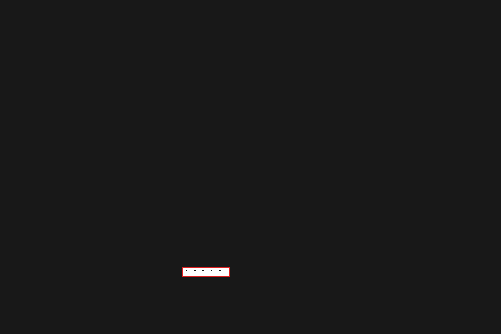
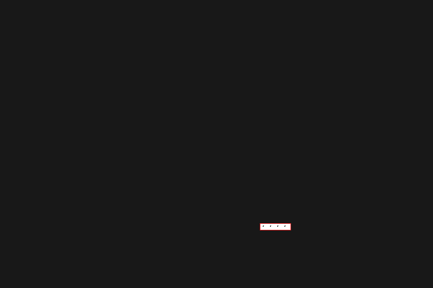

# VobSub review

Source: `dist/demo/source/demo.idx` + `dist/demo/source/demo.sub`  
Frame: `720x480`  
Method: container metadata only. Text was **not** OCRed or guessed. Every cue below is attached to its decoded source image.

Summary: 4 cues, 2 migrated, 2 held for review, 2 with outline/shadow/AA, 1 animated, 0 decode failures.

Boundary verification: **PASS** (3 rounds, 48 checks, 0 failures).

## Cue 0001

- In/out: `00:00:01.000` .. `00:00:02.502` (`1000..2502 ms`)
- Source rect: `x=100 y=390 w=64 h=16`
- Flags: `text_not_recognized_no_ocr`
- ASS: `1000..2500 ms`, delta `+0/-2 ms`, colour `#FFFFFF`, alpha `0`
- Composite check: pixel match `true`, source deltas `+0/-2 ms`

## Cue 0002

- In/out: `00:00:03.000` .. `00:00:04.502` (`3000..4502 ms`)
- Source rect: `x=260 y=382 w=72 h=18`
- Flags: `text_not_recognized_no_ocr, outline_or_shadow_or_antialias`
- ASS: `3000..4500 ms`, delta `+0/-2 ms`, colour `#FFFFFF`, alpha `0`
- Composite check: pixel match `true`, source deltas `+0/-2 ms`

## Cue 0003

- In/out: `00:00:05.000` .. `00:00:07.002` (`5000..7002 ms`)
- Source rect: `x=430 y=370 w=56 h=16`
- Flags: `text_not_recognized_no_ocr, animation, outline_or_shadow_or_antialias`
- ASS: not emitted (unreliable or not representable)

## Cue 0004

- In/out: `00:00:08.000` .. `00:00:08.000` (`8000..8000 ms`)
- Source rect: `x=590 y=390 w=60 h=14`
- Flags: `text_not_recognized_no_ocr, timing_missing_stop`
- ASS: not emitted (unreliable or not representable)
- Notes: SPU has no stop-display command; end time is not guessed

